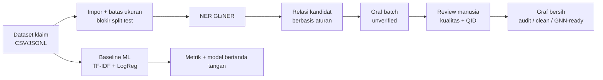

# VeriGraph AI

Workbench untuk membangun **knowledge graph (KG) dari klaim berita** dalam tiga bahasa (Indonesia, Inggris, Mandarin), dengan review manusia di setiap langkah penting. Proyek portofolio Sistem Informasi.

> **Batas klaim yang jujur:** VeriGraph **tidak memverifikasi kebenaran klaim**. Semua relasi yang berasal dari klaim berstatus `unverified`. Baseline ML hanya mengklasifikasi teks klaim, tanpa bukti. Jangan membaca keluarannya sebagai deteksi hoaks.

## Masalah dan solusi

| Masalah | Pendekatan di proyek ini |
|---|---|
| Hasil NER otomatis pada klaim multibahasa sering salah (mis. "American history" dianggap lokasi) | Antarmuka review bertahap: terima, revisi, tolak, atau tandai perlu konteks; semua keputusan tersimpan dengan jejak audit |
| Graf dari klaim mudah disalahartikan sebagai fakta | Skema memaksa `truth_status = unverified`; validasi menolak label emas, bukti, atau justifikasi masuk graf (anti kebocoran data) |
| Identitas entitas ambigu | Wikidata hanya memberi *kandidat*; QID baru masuk setelah disetujui manusia |
| Hasil eksperimen sulit direproduksi | Split data dicek tanpa tumpang tindih, model ditandatangani SHA-256, metrik disimpan di JSON |

## Arsitektur



Detail, ERD data JSON, dan diagram alur review ada di [docs/ARCHITECTURE.md](docs/ARCHITECTURE.md).

## Hasil pengujian (terukur, dijalankan 15 Nov 2026)

| Metrik | Nilai |
|---|---|
| Tes otomatis (pytest) | **130 lulus, 0 gagal** (unit, integrasi, 7 alur E2E UI via Streamlit AppTest) |
| Cakupan baris `src/` | **67%**. Modul logika inti jauh lebih tinggi; modul render Streamlit dicakup sebagian oleh tes E2E |
| Lint (ruff, aturan F/E9) | bersih |
| Kontras warna tema | seluruh pasangan token lulus WCAG AA (diuji di `tests/test_theme.py`) |
| Baseline klaim-saja CFEVER (dev 3.000) | Macro-F1 **0,422** vs. mayoritas 0,167 (TF-IDF + Logistic Regression) |

Baseline 0,422 menunjukkan klaim mengandung pola bahasa yang bisa dipelajari, **bukan** kemampuan memeriksa fakta. Model XLM-R yang di-fine-tune penuh (FP32) runtuh ke satu kelas (Macro-F1 0,167); hasil itu dicatat apa adanya di `docs/MODEL_CARD_V05.md`.

Review KG saat ini: 18 mention dari 5 klaim AVeriTeC, 5 diterima, 2 ditolak, 11 menunggu; 0 QID tervalidasi (`python scripts/kg_coverage_report.py data/examples/batch_kg_v042_reviewed.json`). Review NER pilot CFEVER 50 klaim masih berjalan.

## Menjalankan lokal

```powershell
python -m venv .venv
.\.venv\Scripts\Activate.ps1
pip install -r requirements-dev.txt        # inti + ML + pytest + ruff
python -m pytest -q
streamlit run app.py
```

Fitur opsional: `pip install -r requirements-ner.txt` (NER GLiNER + Wikidata), `requirements-dl.txt` (transformers; pasang PyTorch sesuai perangkat). Salin `.env.example` ke `.env` untuk mengatur `WIKIDATA_USER_AGENT`.

Dataset CFEVER dan AVeriTeC **tidak disertakan**; letakkan sendiri di `data/datasets/` (cek lisensinya). Untuk melatih baseline:

```bash
python scripts/train_ml_baseline.py --dataset cfever --train data/datasets/cfever/train.jsonl --dev data/datasets/cfever/dev.jsonl --output outputs/ml_v05/cfever
```

## Deployment

Aplikasi ini Streamlit (server Python), jadi **bukan** target Vercel. Opsi siap pakai:

- **Docker:** `docker build -t verigraph . && docker run -p 8501:8501 verigraph`
- **Streamlit Community Cloud:** arahkan ke `app.py`, `requirements.txt`; tambahkan `requirements-ner.txt` hanya bila NER dibutuhkan.

Tab NER/Wikidata memerlukan paket opsional dan unduhan model; demo publik tanpa paket itu tetap berjalan untuk tab lain.

## Struktur folder

```text
app.py                  entry Streamlit (8 tab + mode pemula)
src/                    logika KG, review, validasi, tema (lihat CLAUDE.md)
scripts/                CLI: batch KG, latih baseline, laporan cakupan
tests/                  unit + integrasi + E2E UI
data/examples/          contoh KG hasil review (dilacak git)
docs/                   ARCHITECTURE, DATA_CONTRACT, MODEL_CARD_V05, history/
.streamlit/config.toml  tema dan setelan server
```

## Keamanan

- Tanpa kredensial di kode; konfigurasi lewat env (`.env.example`).
- Berkas model joblib hanya dimuat jika cocok dengan tanda tangan SHA-256 (`src/model_integrity.py`); unggahan pickle tidak pernah diterima.
- Impor dataset: batas 75 MB / 1.000 baris / 1.500 karakter per klaim; file split test diblokir.
- Endpoint LLM lokal opsional dibatasi ke loopback (anti-SSRF). Pesan error ke pengguna tidak membocorkan path atau stack trace.
- Penyimpanan keputusan review atomik (tulis ke file sementara lalu ganti) dengan digest sumber untuk mencegah penggabungan data yang tidak cocok.

Proyek ini tidak memakai database relasional maupun akun pengguna; "integritas data" dijaga lewat skema JSON bertingkat dan validasi fail-closed.

## Lisensi dan data

Kode: portofolio edukasi. Lisensi dataset dan model pihak ketiga harus diperiksa sendiri sebelum distribusi.
