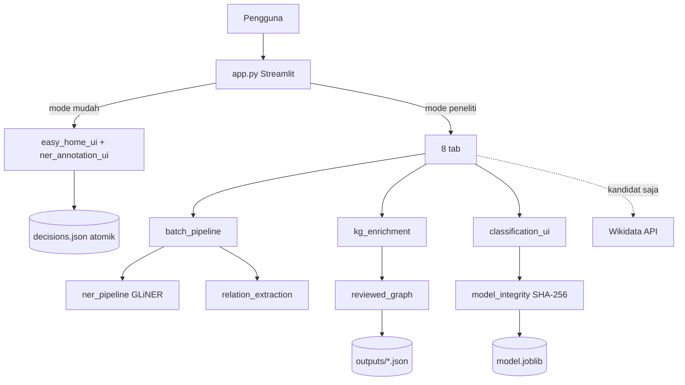
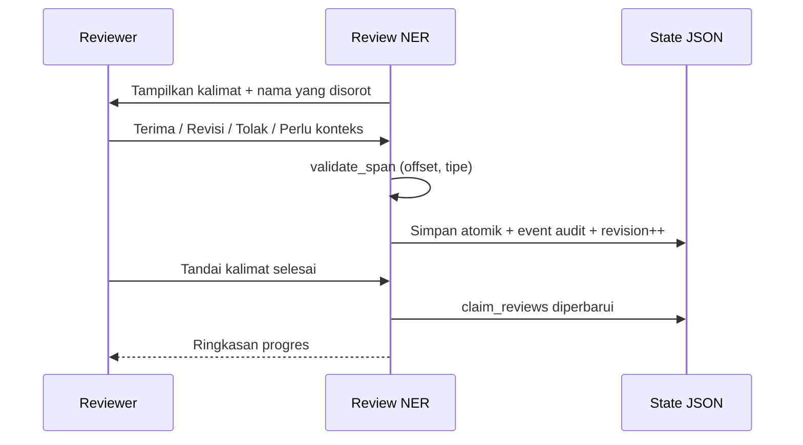
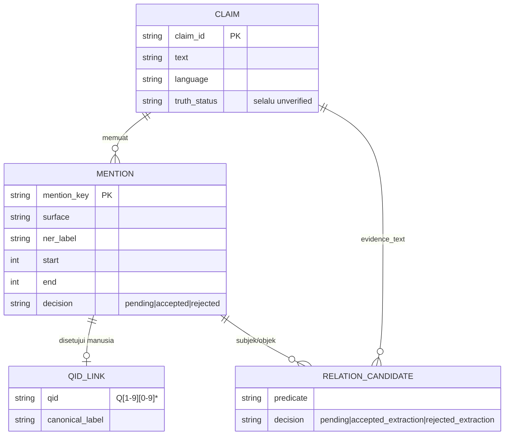

# Arsitektur VeriGraph AI

## Alur sistem

## Alur proses review entitas (bisnis)

## Model data (ERD logis, JSON)

Tidak ada database relasional; entitas di bawah adalah struktur dokumen JSON yang divalidasi di kode.

## Invarian integritas

| Invarian | Penegak |
|---|---|
| Node klaim dan semua edge `unverified` | `reviewed_graph.load_v041` |
| Tidak ada `gold_label`, `evidence_json`, `justification` di graf | `PROHIBITED_FIELDS` |
| Edge tidak boleh menunjuk node yang tidak ada | validasi impor sebelum NetworkX |
| Candidate ID dan span unik, surface cocok dengan offset | `ner_annotation.load_candidates` |
| File keputusan hanya cocok dengan snapshot sumbernya | `source_digest` |
| Train dan dev tidak beririsan | `classification_data.verify_disjoint` |
| Model hanya dimuat bila SHA-256 cocok | `model_integrity.verify_model` |

## Sistem desain

Token warna/tipografi/spasi di `src/theme.py`; semua pasangan teks-latar diuji kontrasnya (WCAG AA). Penanda "belum terverifikasi" memakai garis putus-putus amber, sejajar dengan edge putus-putus untuk asersi di tampilan graf.
